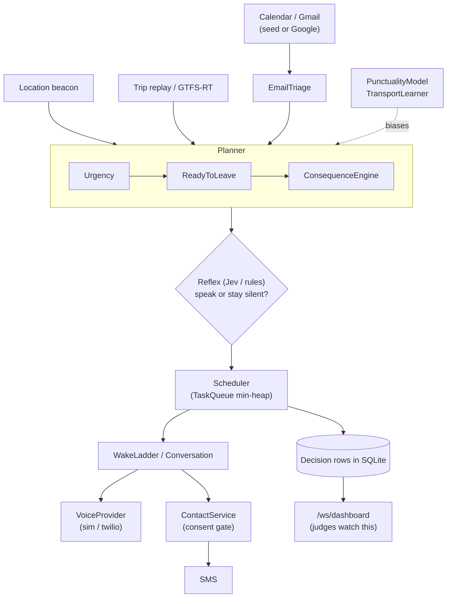
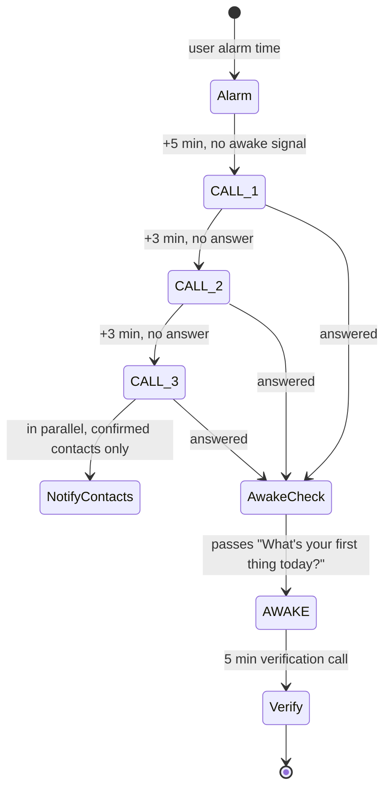
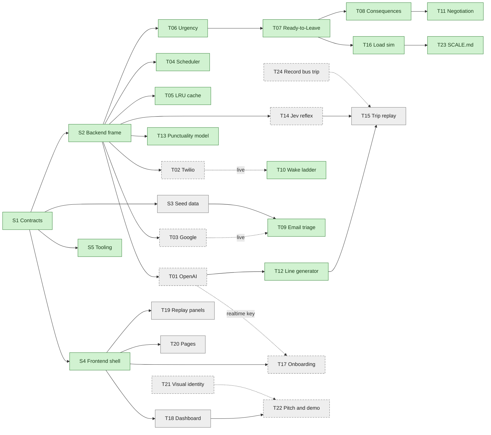

# Enro

> Ontime everytime.

It knows you'll be late before you do.

Enro is a background AI agent that wakes you up, gets you out the door, and learns how late you really run. You talk to it by voice. After a three-minute setup it has no interface. Full spec: [`PRD.md`](PRD.md). Task board: [`TASKS.md`](TASKS.md). Agent rules: [`AGENTS.md`](AGENTS.md).

## How it works

Signals come in, the planner decides when you must leave, the reflex decides whether to speak, and the scheduler acts. Every action becomes a `Decision` row and a dashboard event. Detail in [`docs/ARCHITECTURE.md`](docs/ARCHITECTURE.md).



### Morning wake ladder (PRD 7.6)



### Task dependencies

Done tasks are green, open ones are grey, and tasks that need a local machine (keys, phone, mic, bus ride) have a dashed border. Status as of 2026-10-24. [`TASKS.md`](TASKS.md) and `make todos` are the live source.



## Quick start (fake mode, zero keys)

Needs CMake 3.20+, a C++20 compiler (Apple Clang 15+ or GCC 12+), Node 20+, and Python 3 with `pip install jsonschema websocket-client`.

```bash
make dev-fake      # builds the backend, runs it on :8080 with every provider faked, and Vite on :5173
```

Open http://localhost:5173/dashboard, then trigger the demo beats from the dashboard buttons or:

```bash
curl -X POST localhost:8080/api/demo/trigger -H 'Content-Type: application/json' -d '{"user_id":"u_demo","scenario":"wake_ladder"}'
# scenarios: wake_ladder, leave_reminder, email_drop
make sim           # 100,000-user load simulation
```

In fake mode the phone call happens in the browser at `/call/<call_id>` (the call simulator), lines come from `backend/config/scripts.json`, and calendar, email, and history come from `backend/seed/`.

Frontend alone, with no backend at all: `make frontend` (reads fixtures from `contracts/examples/`, `VITE_USE_MOCKS=true`).

## Make targets

| Target | What it does |
|---|---|
| `make build` | `cmake -S backend -B build && cmake --build build` |
| `make backend` | Run the backend with your `.env` |
| `make frontend` | Vite dev server on :5173, proxies `/api`, `/oauth`, `/audio`, `/ws` to :8080 |
| `make dev` | Backend with your `.env` plus frontend against it |
| `make dev-fake` | Same, with every provider forced to fake. The demo flow |
| `make test` | Backend doctest suite |
| `make contracts` | Every `contracts/examples/*.json` matches its schema |
| `make smoke` | Every section 11 route on a running backend matches its contract |
| `make e2e` | Headless golden path in fake mode on :18080 (boot, smoke, demo beats, dashboard feed) |
| `make sim` | 100,000-user load sim on a running backend |
| `make prerender` | Cache scripted TTS lines into `backend/audio_cache/` (needs `OPENAI_API_KEY`) |
| `make tunnel` | ngrok to :8080 for Twilio and OAuth callbacks |
| `make todos` | Open work, grouped by task ID |

Before a PR: `make test && make contracts && make e2e`.

## Configuration

Copy `.env.example` to `.env`. An empty `.env` (or none) means fake mode. Values in your shell override the file. Never commit `.env`.

### Flipping providers

Each task owner flips their own provider once it works. Everything else stays fake.

| Env var | Fake (default) | Real | Also needs |
|---|---|---|---|
| `VOICE_PROVIDER` | `sim` (browser call simulator) | `twilio` | `TWILIO_ACCOUNT_SID`, `TWILIO_AUTH_TOKEN`, `TWILIO_FROM_NUMBER`, `PUBLIC_BASE_URL` from `make tunnel` |
| `LLM_PROVIDER` | `fake` (canned lines) | `openai` or `anthropic` | `OPENAI_API_KEY` + `OPENAI_CHAT_MODEL`, or `ANTHROPIC_API_KEY` (+ optional `ANTHROPIC_MODEL`, default `claude-opus-5-5`) |
| `REFLEX_PROVIDER` | `rules` | `jev` | `TYPESAFE_API_KEY`, `JEV_MODEL` |
| `CALENDAR_SOURCE` | `seed` | `google` | `GOOGLE_CLIENT_ID`, `GOOGLE_CLIENT_SECRET`, then sign in at `/oauth/google/start` |
| `EMAIL_SOURCE` | `seed` | `gmail` | same Google client |
| Routing | fixed speeds per mode | Google Routes when the key is set | `GOOGLE_MAPS_API_KEY` |

Voice (TTS, transcription, Realtime onboarding) always uses OpenAI when real, because the Claude API has no audio output.

### Google OAuth client

Create a **Web application** OAuth client in Google Cloud Console:

- Authorized redirect URI: `http://localhost:8080/oauth/google/callback`, plus `https://<ngrok-domain>/oauth/google/callback` when tunnelling
- Authorized JavaScript origin: `http://localhost:5173`
- Scopes: `calendar.events.readonly` and `gmail.readonly` only
- Consent screen in Testing mode with each teammate added as a test user

### Twilio

Trial accounts only call verified numbers, so verify every demo phone early. Point the number's voice webhook at `$PUBLIC_BASE_URL/twilio/voice` and its messaging webhook at `$PUBLIC_BASE_URL/twilio/sms`.

## Prototype learnings

A parallel TypeScript prototype (branch `prototype-handoff-2026-10-24`) worked through real-phone calling, phone motion, and Google setup. Its lessons, ported to this backend's routes:

- [`docs/PROTOTYPE_LEARNINGS.md`](docs/PROTOTYPE_LEARNINGS.md): decisions, safety rules, motion details, and what's still unproven, mapped to tasks
- [`docs/PHONE_TEST.md`](docs/PHONE_TEST.md): physical-phone runbook (tunnel, Twilio webhooks, Sensor Logger, acceptance steps)
- [`docs/GOOGLE_SETUP.md`](docs/GOOGLE_SETUP.md): OAuth client, scopes, Routes key, travel-mode nuances
- [`docs/research/`](docs/research/): the prototype's historical research notes, verbatim

## Repo layout

| Path | What |
|---|---|
| `backend/` | C++20 server: Crow, cpr, nlohmann/json, SQLiteCpp, all via CMake FetchContent |
| `backend/config/`, `backend/seed/` | Personas, canned lines, event types; the demo user's calendar, inbox, history, and bus trip |
| `frontend/` | React + TypeScript + Vite + Tailwind. Landing, onboarding, judge dashboard, call simulator, beacon |
| `contracts/` | JSON schemas and examples for every route and websocket event. Frozen; see `contracts/README.md` |
| `docs/` | Vision, architecture, demo script, scale, privacy, risks |
| `scripts/` | Contract check, smoke test, e2e, TTS prerender, how to record a bus trip |

GTFS-realtime (live transit) needs protobuf, which is optional at build time: `brew install protobuf` or `apt install libprotobuf-dev protobuf-compiler`. Without it the backend uses trip replay only.

## Working agreement

One task = one branch (`T07-ready-to-leave`) = one owner. Edit only the files your task owns. Small PRs, merged often. `main` always builds and boots in fake mode. In Claude Code, ship with `/shipit`.
