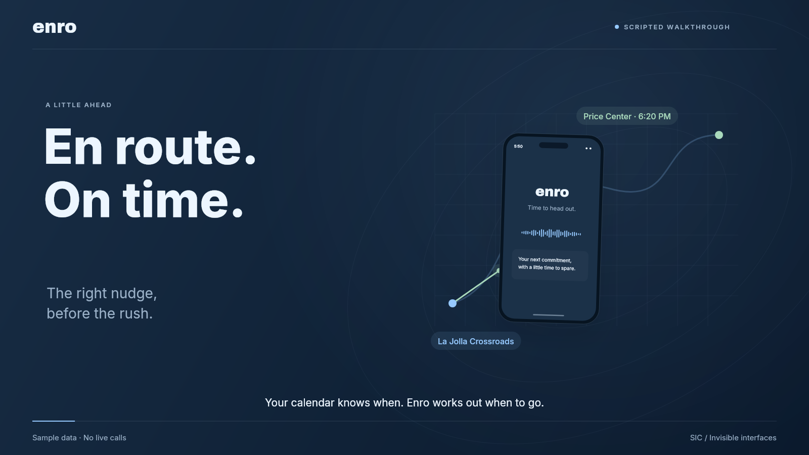

<p align="center"><a href="https://enro-sic.vercel.app"></a></p>

<h1 align="center">En route. On time.</h1>

<p align="center">A call to get you up. A little help getting out the door.</p>

<p align="center"><a href="https://enro-sic.vercel.app">Try Enro</a> · <a href="https://enro-sic.vercel.app/demo">Explore the demo room</a> · <a href="https://enro-sic.vercel.app/dashboard">Team dashboard</a> · <a href="docs/INTEGRATION.md">Build status</a></p>

[](https://enro-sic.vercel.app/demo)

Enro plans backward from your next commitment. It combines the event time, travel, time to get ready, and an arrival buffer. A phone call gives you a reason to get moving, with a reminder when it is time to leave.

Built for the SIC Invisible Interfaces challenge. The phone call is the daily interaction. The website handles setup and makes the reasoning visible during the demo.

## Try the demo

[The public site](https://enro-sic.vercel.app) works without an account. Choose a sample event, change your travel mode, preview a call, and see how a delay changes your departure. The demo room also includes the Crossroads to Price Center scenario, sensor evidence, and the Lookahead studio. The team dashboard uses its contract fixtures.

Public calls, events, sensor signals, and forecasts are illustrative. Your real inbox, phone number, location, and operator controls stay local.

## What is here

| Part | What it does | Status |
| :--- | :--- | :--- |
| Public demo | Sample morning, call preview, departure changes, and Lookahead | Runs on Vercel with sample data |
| Team build | C++ planner, durable scheduler, wake ladder, negotiation, learned punctuality, and React dashboard | Runs locally in fake mode; real providers are configured separately |
| Phone prototype | Twilio calls, Google event imports, route planning, and native phone sensor ingestion | Working local integration in `prototype/` |
| Walking check | Fresh counter increments, Activity, and spoken response | Experimental; revised rule still needs physical validation |

Both implementations are preserved in main. They have separate schedulers and call state. The public site brings their views together; it does not connect the two backends. [Integration notes](docs/INTEGRATION.md) define the handoff.

## Run locally

The team build needs a C++20 compiler, CMake 3.20 or later, Node 20 or later, and Python with `jsonschema` and `websocket-client`.

```sh
make dev-fake
```

Open [the team dashboard](http://localhost:5173/dashboard). Fake mode uses no API keys. The [team setup guide](docs/TEAM_BUILD.md) covers provider settings, commands, and architecture.

The phone prototype needs Node 22.13 or later.

```sh
cd prototype
npm ci
cp .env.example .env
npm start
```

Open [the local prototype](http://localhost:3333). Keep an existing `.env` when restarting. [Prototype setup](prototype/README.md), [Google setup](prototype/docs/GOOGLE_SETUP.md), and [phone test notes](prototype/docs/PHONE_TEST.md) explain the live integrations. Plans begin disarmed.

## What the phone test taught us

A real call and concurrent sensor delivery worked. A later trial exposed a false positive: seven vertical shakes were counted as seven steps, and the old counter plus voice rule ended the call. The user had not walked.

The revised experiment also requires fresh walking or running Activity. Phone position only describes the device. Neither a pedometer count nor a spoken response proves wakefulness. Walking versus shaking and background reliability still need physical tests. The public demo makes that distinction visible.

## Project map

| Path | Contents |
| :--- | :--- |
| `backend/` | C++ server, planning, scheduling, providers, and persistence |
| `frontend/` | React onboarding, dashboard, replay, and browser call simulator |
| `contracts/` | Shared schemas and fixtures |
| `prototype/` | TypeScript phone integration, tests, design originals, research, and demo exports |
| `prototype/public/demo/` | Interactive story, sample day, and Lookahead studio |
| `docs/` | Architecture, team setup, integration notes, pitch, privacy, and scale |
| `scripts/build_demo.mjs` | Builds the public site with fixtures and no operator pages |

## Check and publish

```sh
make test
make contracts
make e2e
npm --prefix frontend ci
npm --prefix frontend run build
npm --prefix prototype ci
npm --prefix prototype run typecheck
npm --prefix prototype test
node --test prototype/public/demo/stage-model.test.mjs prototype/public/demo/lookahead/model.test.mjs
node scripts/build_demo.mjs
```

Vercel uses `vercel.json` to build the public demo into `site-dist/`. No Twilio or Google credentials are needed for that deployment. See [the release notes](docs/RELEASE.md) for the verified checks.

The original [PRD](PRD.md), [task board](TASKS.md), and [architecture](docs/ARCHITECTURE.md) remain the team build references.
